# 酷DO

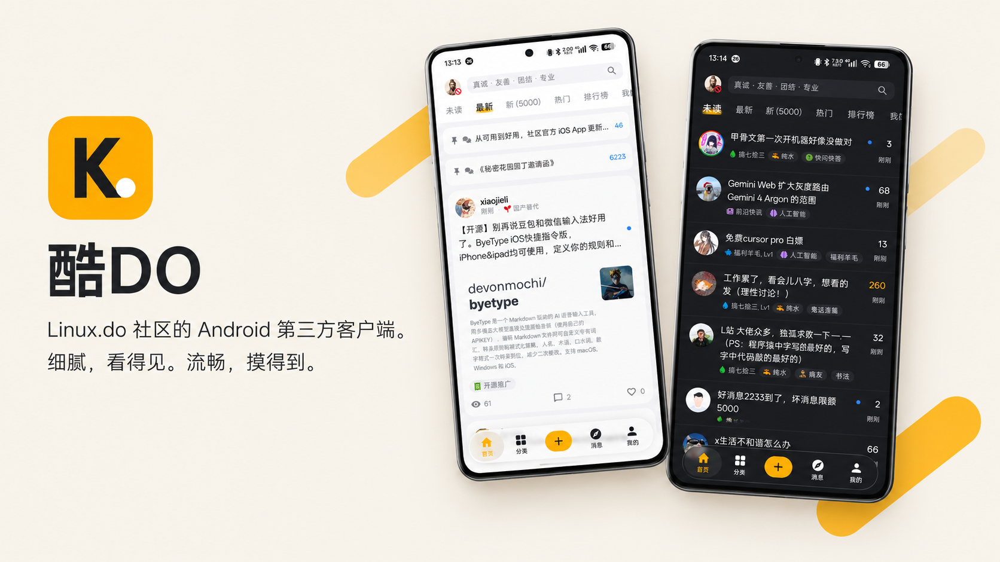

Linux.do 社区的 Android 原生第三方客户端，使用 Kotlin 与 Jetpack Compose 开发。以社区 Logo 的黄色为主色，结合液态玻璃材质，提供原生话题阅读、社区互动和账号管理。

支持 **Android 8.0 及以上**，当前安装包仅提供 **arm64-v8a**。

[下载最新版本](https://github.com/woliubang256/kudo-android/releases/latest) · [构建与安装](docs/BUILDING.md) · [第三方组件与参考](THIRD_PARTY_NOTICES.md)

界面预览

### 浅色模式

| 首页 · 信息流 | 首页 · 标题 | 分类 |
| --- | --- | --- |
| 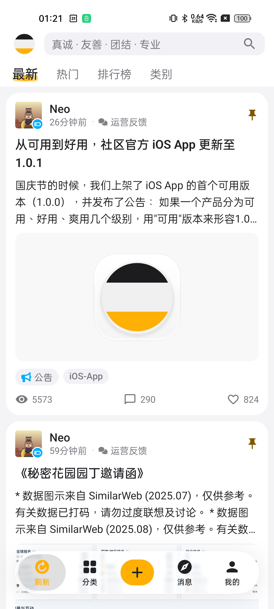 | 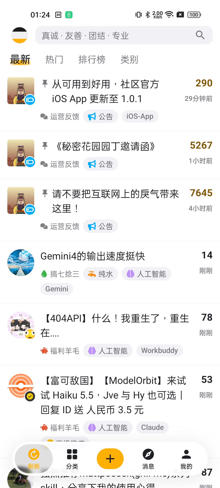 | 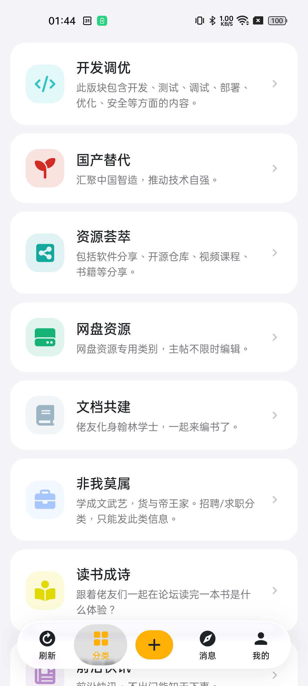 |

| 话题详情 | 用户主页 | 设置 |
| --- | --- | --- |
| 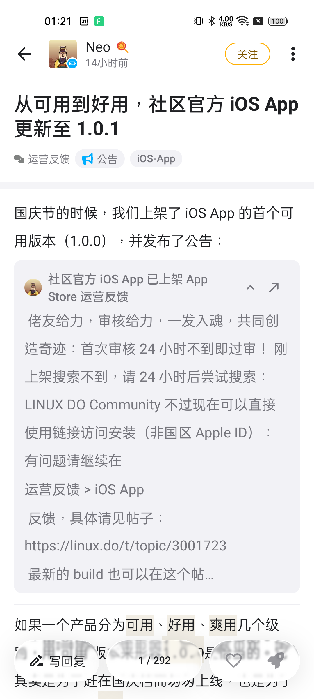 | 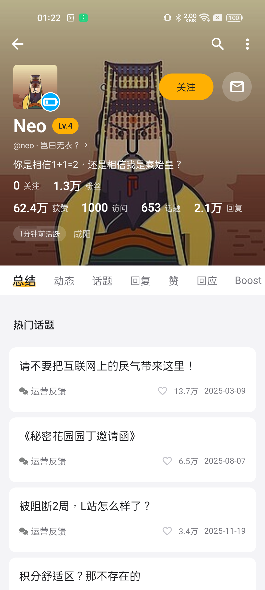 | 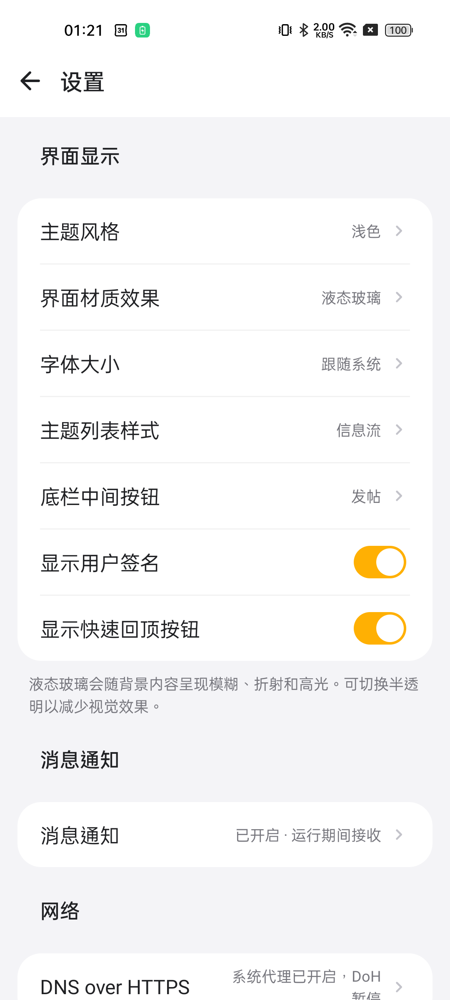 |

### 深色模式

| 首页 · 信息流 | 首页 · 标题 | 分类 |
| --- | --- | --- |
| 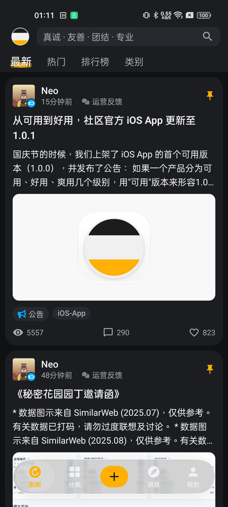 | 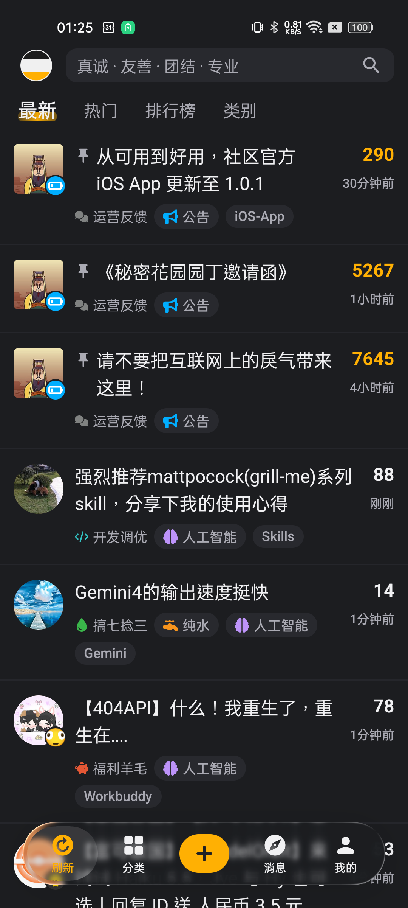 | 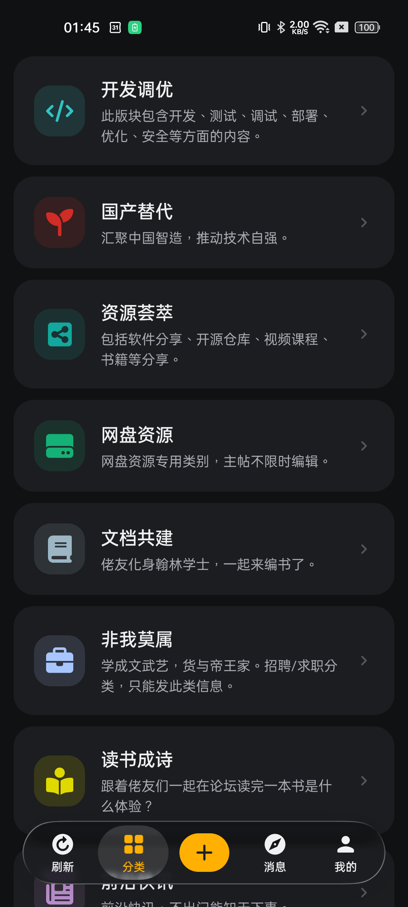 |

| 话题详情 | 用户主页 | 设置 |
| --- | --- | --- |
| 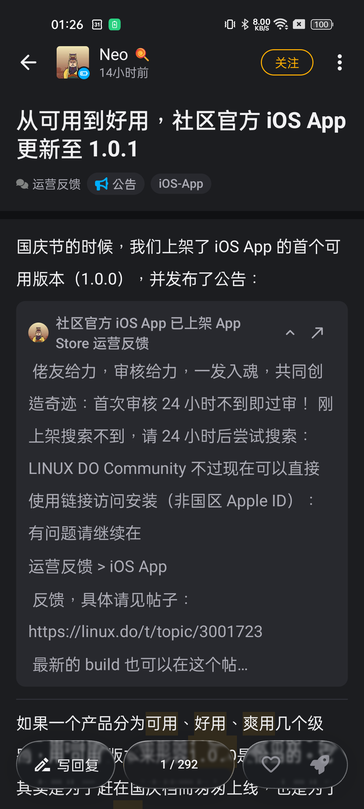 | 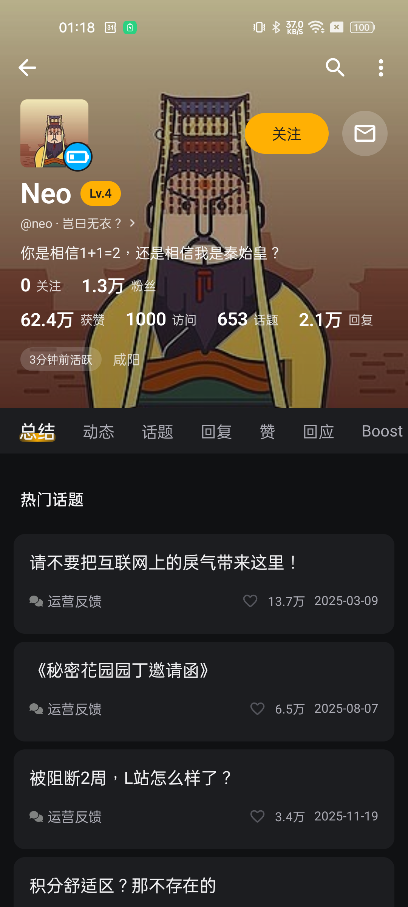 | 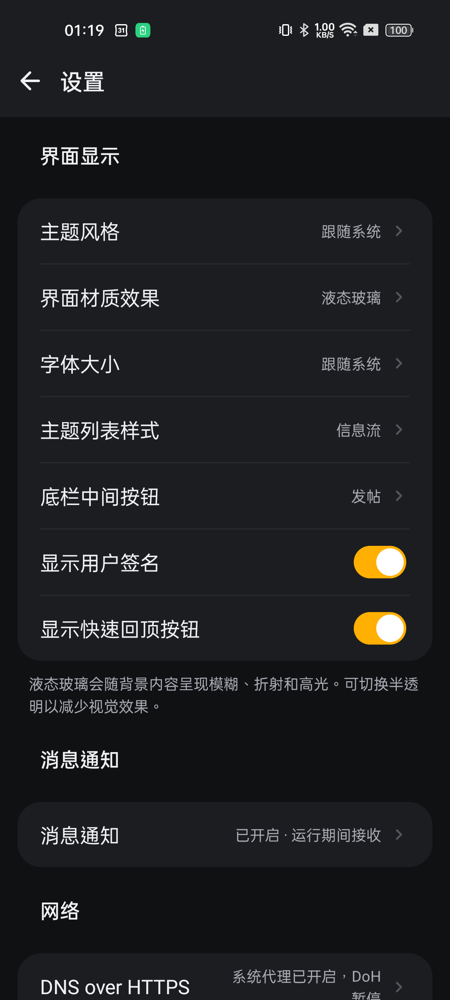 |

## 功能

- **浏览与发现**：首页筛选、分类与标签列表、搜索、下拉刷新和分页；有新内容时提示刷新，保留当前阅读位置。
- **原生阅读**：楼层跳转、双向分页、阅读位置续读，以及引用、代码块和回复关系展示。
- **图片与剧透**：全屏缩放、长图和宽图浏览、惯性滚动、加载与重试提示；文字和图片剧透支持点击切换模糊状态。
- **社区互动**：点赞、收藏、发帖、回复、图片上传，按账号和话题保存草稿。
- **账号与通知**：官网 WebView 登录、Cloudflare 网页验证、个人主页和通知。
- **界面设置**：浅色、深色或跟随系统，支持字号调整、兼容材质切换与快速回顶开关。
- **DoH + ECH**：默认关闭，支持内置及自定义服务器管理；检测到 VPN 或系统代理时自动暂停，断开后按原选择恢复。

Android 13+ 使用完整液态玻璃，Android 12 使用背景模糊，Android 8–11 使用半透明材质。设置中可主动切换兼容材质。

## 使用说明

- 搜索需要登录；首次访问或遇到 Cloudflare 验证时，请在应用的官网页面完成验证，再返回重试。
- DoH + ECH 用于原生网络请求。WebView 登录、网页验证、外链和 GitHub 更新检查使用系统网络；ECH 不能保证免于 Cloudflare 验证。
- 复杂 Discourse 插件、数学公式、音视频和部分富文本格式可通过详情页的网页入口查看。
- 网络结果不明的写请求不会自动重试，请先刷新确认是否成功，避免重复提交。
- Cookie 与草稿存放在应用私有目录，禁用备份与设备迁移；退出会清除本机账号数据。外部图片直接向其来源站点请求。
- 部分账号功能、Android 12 专用模糊分支、平板和折叠屏仍需真实环境验收。测试说明见[构建与安装](docs/BUILDING.md#验证)，验收记录见 [TASKS.md](TASKS.md)。

## 开发

环境准备、本地构建、保留数据安装、签名配置、版本规则、Tag 发布及测试命令统一放在[构建与安装文档](docs/BUILDING.md)。

## 许可证与致谢

项目主体代码由 Bang Liu 及贡献者以 [Apache License 2.0](LICENSE) 授权。第三方依赖、图标和改编示例遵循各自的许可证，详见[第三方组件与参考](THIRD_PARTY_NOTICES.md)。

接口行为参考 [FluxDO](https://github.com/Lingyan000/fluxdo)，界面材质改编自 [Backdrop 官方示例](https://github.com/Kyant0/AndroidLiquidGlass)。酷安作为布局与交互参考，未使用其 APK 资源或反编译代码。

## Linux.do 认可

本项目积极参与并认可 [linux.do社区](https://linux.do)。

